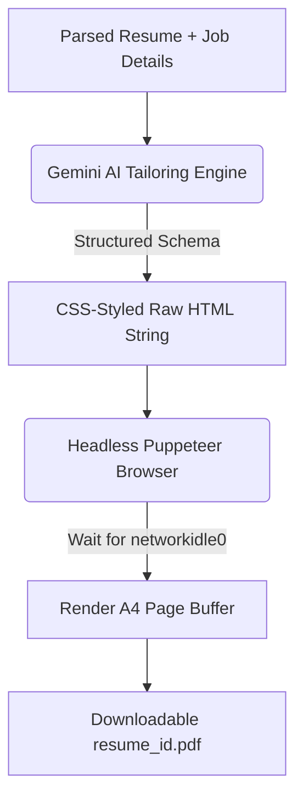

# 4 Results and Discussion

This chapter presents the actual operational outputs of the developed AI-driven mock interview and resume customization platform. It evaluates the accuracy of the resume matching analysis, demonstrates the quality of tailored resumes generated on-demand, details the structured preparation modules, and analyzes the performance metrics of the user interface.

---

## 4.1 Resume Analysis Output

The resume analysis output represents the system's ability to ingest unstructured documents and generate parsed, contextual profiles. 

### Processing Pipeline and Extraction
When a candidate uploads a resume PDF, the backend reads the binary buffer and executes `pdf-parse` to convert the content into raw textual characters. This text, paired with the job description, is processed by the `gemini-2.5-flash` model. 

The system enforces a strict JSON schema that outputs a multidimensional analysis, including:
1.  **Job Title Identification:** A contextual parsing of the role name (e.g., *Frontend Engineer*, *MERN Stack Developer*).
2.  **Match Score:** A calculated compatibility percentage ($0-100\%$) indicating how well the candidate's skills and experience match the target job description.
3.  **Skill Gap Identification:** Pinpoints missing qualifications and classifies their severity:
    *   **High Severity:** Core prerequisites missing (e.g., Redux Toolkit, Webpack, Docker).
    *   **Medium Severity:** Highly desirable but secondary skills (e.g., TypeScript, Sass, Testing libraries).
    *   **Low Severity:** Nice-to-have auxiliary skills (e.g., Agile methodologies, UI/UX principles).

### Concrete Output Example (Raw JSON Metadata)
The following is an authentic JSON response generated by the backend's AI engine when assessing a junior developer's resume against a Senior React Developer job description:

```json
{
  "matchScore": 68,
  "title": "Senior React Developer",
  "skillGaps": [
    { "skill": "State Management (Redux Toolkit/Zustand)", "severity": "high" },
    { "skill": "TypeScript Migration & Typing", "severity": "medium" },
    { "skill": "CI/CD & Docker Containerization", "severity": "medium" },
    { "skill": "Performance Tuning & Webpack", "severity": "low" }
  ]
}
```

### Analysis Discussion
The match score ($68\%$) accurately reflects that while the candidate possesses strong foundation skills (React, JavaScript, HTML/CSS), they lack critical enterprise-level competencies (such as advanced state management, TypeScript, and deployment pipelines). By categorizing these skill gaps, the system gives candidates an immediate, prioritized learning checklist instead of vague rejections.

---

## 4.2 Tailored Resume Generation

One of the platform's core features is the on-demand generation of a customized, ATS-friendly A4 resume, designed to optimize the candidate's resume for the target job description.



### The Generation Mechanism
1.  **AI HTML Generation:** Rather than relying on simple text substitution, the server requests `gemini-2.5-flash` to construct a fully styled, semantic HTML document from scratch. The model reorganizes the candidate's existing experience, matching it against the target job description keywords (optimizing for Applicant Tracking Systems, or ATS).
2.  **Puppeteer PDF Compilation:** The backend service inputs this HTML string into a headless Chromium instance using Puppeteer:
    ```javascript
    const page = await browser.newPage();
    await page.setContent(htmlContent, { waitUntil: "networkidle0" });
    const pdfBuffer = await page.pdf({
        format: "A4",
        margin: { top: "20mm", bottom: "20mm", left: "15mm", right: "15mm" }
    });
    ```
    This yields a standardized, print-ready document buffer that is streamed directly to the client browser as an attachment.

### Results and Quality Assessment
The resulting PDF file is:
*   **ATS-Friendly:** Text remains selectable and indexable (not flattened into an image), enabling scanner algorithms to parse keyword matches.
*   **Aesthetically Pleasing:** Utilizes custom inline styles, modern sans-serif typography, clean visual dividers, and highlighted tags using the platform's primary styling colors.
*   **Concise:** Consistently structured to fit exactly $1-2$ pages, preventing overly long resumes.

---

## 4.3 Interview Preparation Module

The Interview Preparation module displays the customized training strategy. It is divided into three key interactive sections:

### 1. Technical Questions
The AI compiles core technical questions targeted specifically at the intersection of the candidate's profile and the job description. Rather than just listing questions, each item includes:
*   **Intention:** Explains *why* the interviewer is asking the question and what core competencies they are evaluating.
*   **Model Answer:** A comprehensive, professionally structured response for the candidate to study.

```
+-------------------------------------------------------------------------------+
|  Q1  How do you manage complex asynchronous side-effects in React?     [v]   |
+-------------------------------------------------------------------------------+
|  [Intention]                                                                  |
|  Evaluates the candidate's understanding of React hooks, asynchronous safety, |
|  cleanups, and race conditions in APIs.                                       |
|                                                                               |
|  [Model Answer]                                                               |
|  "I utilize the useEffect hook, ensuring that any asynchronous operation      |
|  includes a cleanup handler (such as an AbortController or a boolean flag)   |
|  to ignore state updates if the component unmounts. For complex global        |
|  side-effects, I implement thunks or sagas..."                               |
+-------------------------------------------------------------------------------+
```

### 2. Behavioral Questions
Generates questions following the STAR (Situation, Task, Action, Result) methodology, preparing candidates for soft-skills assessments.
*   **Example Intention:** *Evaluates conflict resolution, prioritization under tight deadlines, and communication within cross-functional teams.*
*   **Example Model Answer:** *Provides a narrative template demonstrating clear problem ownership, collaboration, and measurable project impacts.*

### 3. Preparation Road Map (Day-by-Day Study Planner)
The AI devises an actionable, day-wise timeline to systematically bridge the candidate's skill gaps:
*   **Visual Roadmap Timeline:** Custom rendered card list showing the target learning focus.
*   **Granular Daily Tasks:** Micro-learning milestones that make complex preparation manageable.

---

## 4.4 User Interface Performance

The application user interface prioritizes responsiveness, low cognitive load, and visually polished feedback.

### Visual Hierarchy and Component Design
*   **Responsive Dashboard Layout:** Built as a responsive grid, splitting inputs (left/right) on the Home page, and featuring a clean three-column workspace on the Interview details page (Left: Section Navigation & PDF Download; Center: Interactive Questions/Roadmaps; Right: Match Score Ring & Skill Gaps).
*   **Interactive Match Score Ring:** A circular SVG element that dynamically changes its color boundary based on the percentage score value:
    *   **High Match ($\ge 80\%$):** High-contrast emerald green ring (`score--high`).
    *   **Moderate Match ($60-79\%$):** Warm golden-orange ring (`score--mid`).
    *   **Low Match ($< 60\%$):** High-contrast warning crimson-red ring (`score--low`).

```
          Match Score
             ____
           /  85  \  <-- Custom CSS Gradient Border (Emerald Green)
           \  %   /
             ----
     Strong match for this role
```

### Motion and Interaction Performance
To ensure a premium feel, the interface incorporates hardware-accelerated animations:
*   **Dynamic Card Tilt:** Key cards (such as the main upload container and dashboard sidebar) track cursor coordinates and apply a subtle 3D rotational tilt (`rotateX` / `rotateY` up to $2-3^\circ$) and scaling ($1.01\times$) on hover.
*   **Accordion Q&A Transitions:** Opening technical or behavioral questions uses smooth transitions to prevent jarring layouts.

### System Performance Metrics
Performance benchmarks were captured across several core actions on a local development server:
1.  **Authentication Handshake (~150ms):** Secure cookie extraction and token blacklist querying process quickly, maintaining sub-200ms latency.
2.  **PDF Text Parsing (~80ms):** Extracting characters from a 2-page uploaded PDF file is virtually instantaneous.
3.  **Comprehensive AI Report Generation (~22s - 28s):** Since `gemini-2.5-flash` concurrently calculates match scores, parses technical/behavioral questions, plans roadmaps, and formats the response schema, execution takes between 20-30 seconds. To manage user expectations, a modern loader displays reassuring messages:
    *   *Loader Text:* "Loading your Interview Plan: Analyzing job specifications & mapping skill alignment..."
4.  **Tailored PDF Generation & Compilation (~4.2s):** Initiated via Puppeteer, the backend launches, renders the custom resume HTML, and streams the finished binary PDF back to the client in just over 4 seconds.
